### What I do

<!-- what:start -->
I build AI-backed software for e-commerce and product data: feed pipelines, AI field mapping and translation, marketplace integrations, and the web applications around them. Most recently I was the engineer behind supplier feeds and marketplace integrations at DeinDeal, a Swiss marketplace, where the pipeline I built translated 800,000+ products into four languages.

- **AI agents:** agentic workflows that plan, call tools and act: a site monitor whose agent opens pull requests with fixes, AI field mapping that leaves a field empty when it is unsure.
- **AI systems:** model gateways with routing, retries, a circuit breaker and cost tracking; evals for mapping quality; embeddings with pgvector.
- **Automation:** scheduled pipelines, scrapers, supplier feed sync over CSV, XML, FTP and SFTP, automated reporting, GitHub Actions.
- **Front end:** React, Astro, TypeScript, Tailwind, GSAP scroll and SVG animation, design systems, three-language sites.
- **Back end and data:** Laravel, PostgreSQL, queues, category matching, translation memory.
<!-- what:end -->

### What I'm building

<!-- repos:start -->

<!-- repos:end -->

### Projects

<!-- projects:start -->
- **[Arogi Kos](https://onehublabs.com/projects/arogi-kos)**: Brand-led website, designed with Claude Design and AI-assisted build. Claude Design · Laravel · Tailwind CSS
- **[FeedGenix](https://onehublabs.com/projects/feedgenix)** (Private beta): Product feeds for cross-border merchants: AI field mapping, in any language. Laravel · React · PostgreSQL · LLMs
- **[Kalimera](https://onehublabs.com/projects/kalimera)**: A travel platform in three parts: a travel guide, an online booking system and an affiliate network. Statamic · Laravel · Alpine.js · Tailwind CSS
- **[La Islakos](https://onehublabs.com/projects/la-islakos)**: Online store of La Isla, a boutique on Kos for clothes and accessories by Greek and European designers. PrestaShop
- **[Arangia](https://onehublabs.com/projects/arangia)**: Property brand site and the booking operation behind it, across Airbnb and Booking.com. React · Vite · Tailwind CSS
- **[DeinDeal](https://onehublabs.com/projects/deindeal)**: Marketplace engineering for a large Swiss online marketplace: small suppliers connected to major European marketplaces. LLMs · React · Channable
- **[Delian & Co.](https://onehublabs.com/projects/delian-co)**: Website of Delian & Co., an independent multi-family office in Zürich serving professional athletes. React · Vite · Tailwind CSS
- **[OurBnb](https://onehublabs.com/projects/ourbnb)**: Short-term rental management on Kos, and the platform that runs it. Python · Django · PostgreSQL · WhatsApp
- **[Sunny Days](https://onehublabs.com/projects/sunny-days)**: Website of Sunny Days, a family-run hotel on the beach of Tigaki, Kos. Statamic · Laravel
<!-- projects:end -->

### Get in touch

[onehublabs.com](https://onehublabs.com) · [LinkedIn](https://www.linkedin.com/in/petros-platon-pikionis-4045a782/) · [petrospikionis@gmail.com](mailto:petrospikionis@gmail.com)

The cards are SVG, drawn by <a href="./scripts/render_readme_cards.py">one Python script</a> from my contribution data and kept current by a GitHub Action: every morning it reads my public repositories and the projects on onehublabs.com, so new work shows up here on its own.
