### What I do

I build AI-backed software for e-commerce and product data: feed pipelines, AI field mapping and
translation, marketplace integrations, and the web applications around them. Most recently I was the
engineer behind supplier feeds and marketplace integrations at DeinDeal, a Swiss marketplace, where the
pipeline I built translated 800,000+ products into four languages.

- **AI systems:** model gateways with routing, retries and cost tracking; evals for mapping quality; agents that open pull requests with fixes.
- **Product data:** supplier feeds over CSV, XML, FTP and SFTP; category matching; translation memory.
- **Full stack:** Laravel, React, Astro, PostgreSQL, TypeScript.

### What I'm building

### Get in touch

[onehublabs.com](https://onehublabs.com) · [LinkedIn](https://www.linkedin.com/in/petros-platon-pikionis-4045a782/) · [petrospikionis@gmail.com](mailto:petrospikionis@gmail.com)

The cards are SVG, drawn by <a href="./scripts/render_readme_cards.py">one Python script</a> from my contribution data and refreshed every morning by a GitHub Action.
